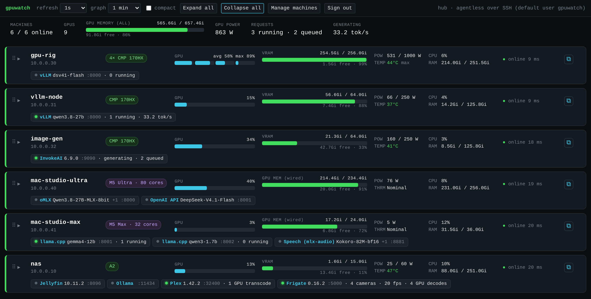
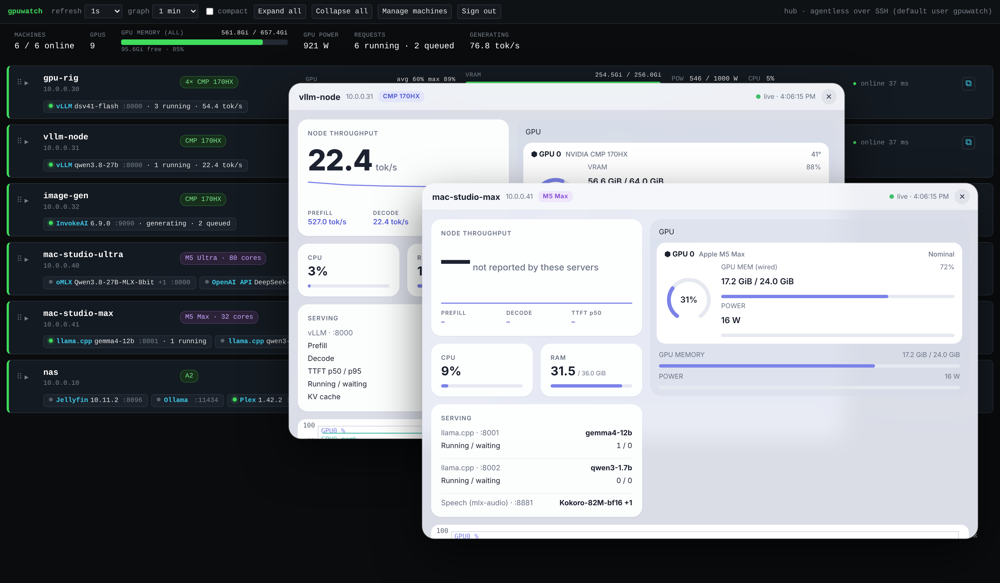
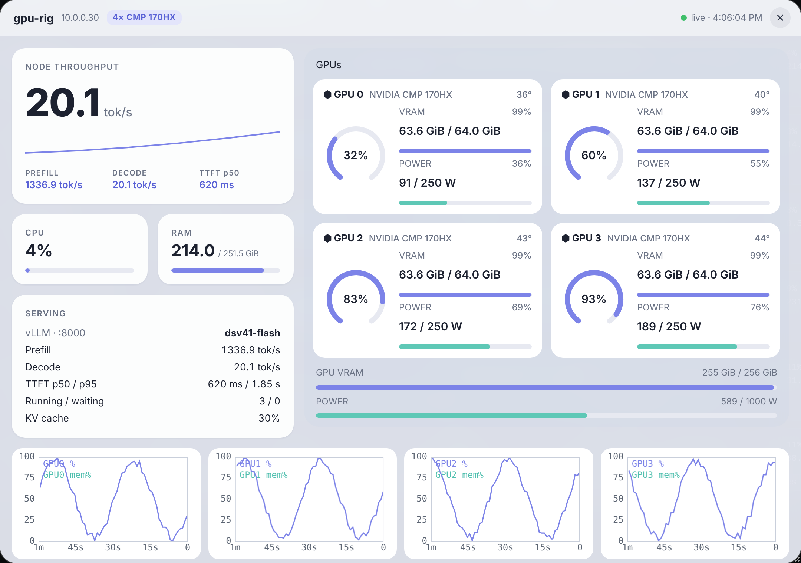
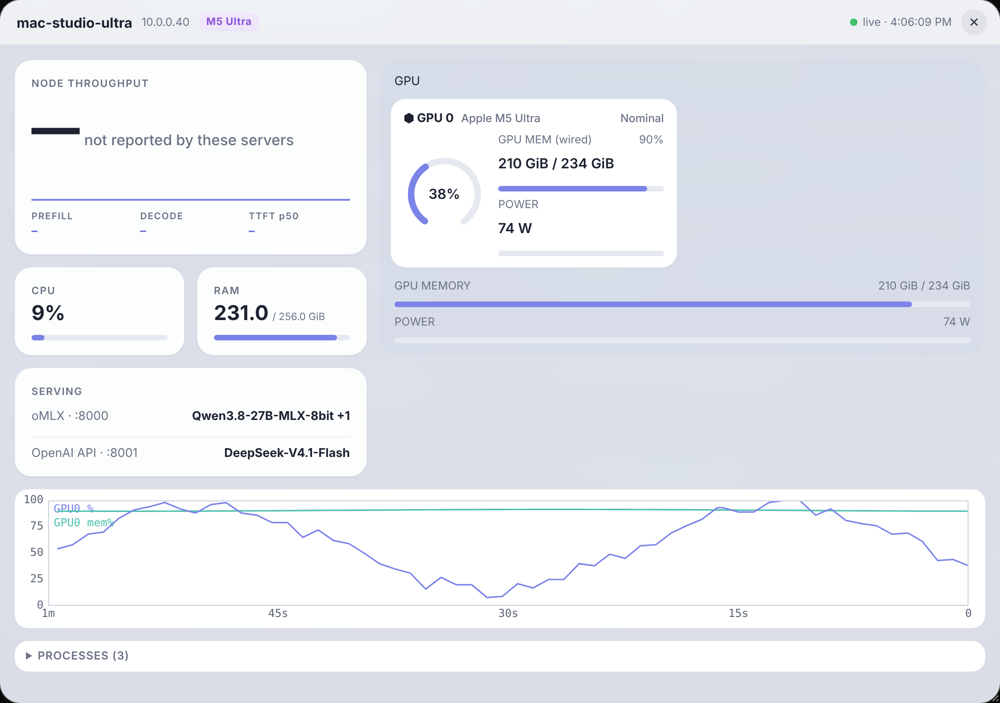
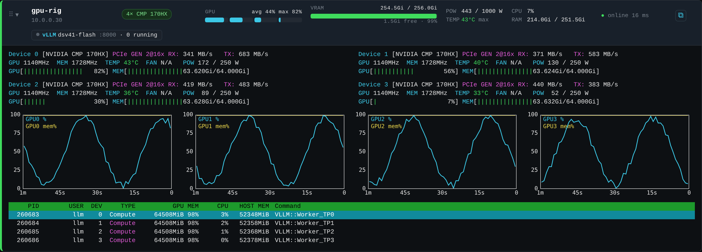
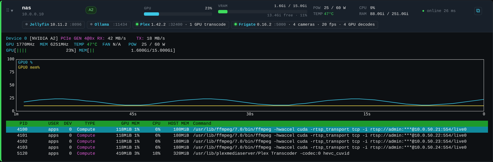

# gpuwatch

**An nvtop-style web dashboard for every GPU machine on your LAN: NVIDIA and Apple Silicon side by side, with no agent to install.**

One small container (the *hub*) connects to each machine over SSH, runs a tiny collector in memory, and streams live GPU stats back to a single page. It also recognises what each machine is serving (vLLM, llama.cpp, Ollama, oMLX, InvokeAI, ComfyUI, Plex, Jellyfin, Frigate) and shows requests, queue and tokens/s.



Click ⧉ on any machine to open it in a floating window. Windows can be moved, resized and stacked, and they remember where you left them:



<table>
<tr>
<td></td>
<td></td>
</tr>
<tr>
<td></td>
<td></td>
</tr>
</table>

## Features

- **Detail windows:** ⧉ opens a machine in a floating window that you can move, resize and stack. It shows per-GPU tiles with utilization rings and VRAM/power bars, headline tok/s with a sparkline, and a serving panel (prefill/decode tok/s, TTFT p50/p95, running/waiting, KV cache %), plus graphs and processes. Esc closes the top one.
- **Fleet overview:** one card per machine with GPU usage (a segment per GPU), GPU memory used/free, power, temperature, host CPU/RAM and status. Click a card for the full nvtop-style view: per-GPU lines, PCIe RX/TX, 1/5/15-minute graphs and a process table.
- **NVIDIA** via `nvidia-smi`: utilization, VRAM, clocks, temperature, fan, power, PCIe, and per-process VRAM.
- **Apple Silicon** via `ioreg`/`top` (plus `powermetrics` when allowed): GPU utilization, GPU-allocated memory against the wired limit (`iogpu.wired_limit_mb`), clock, power and thermal state.
- **Service detection:** finds model and media servers by their APIs.

  | Server | Shows |
  |---|---|
  | vLLM | model, running/queued, prefill and decode tok/s, TTFT p50/p95, KV cache % |
  | llama.cpp `llama-server` | model, busy slots (+ prefill/decode tok/s, queue and KV cache with `--metrics`) |
  | Ollama | loaded models |
  | oMLX and other OpenAI-compatible APIs | model list |
  | InvokeAI / ComfyUI | generating or idle, queue |
  | Plex, Jellyfin | their own GPU transcodes |
  | Frigate | cameras, fps, GPU decodes |

  Servers that need an API key can be pinned with their key, and unclaimed GPU `ffmpeg` streams get their own chip.
- **Fleet totals:** machines online, GPUs, total GPU memory, power, requests and tok/s.
- **Drag to reorder** machines, collapse or expand cards, and a compact mode.
- **Prometheus** `/metrics` and a flat JSON `/api/summary` for Homepage-style widgets.
- **Locked down:** login, CSRF protection, hash-pinned CSP, restricted SSH keys, non-root read-only container, and secrets redacted on the machine. See [SECURITY.md](SECURITY.md).

## Quick start

```sh
git clone https://github.com/ReclaimedNode/gpuwatch && cd gpuwatch
cp .env.example .env        # set GPUWATCH_PASSWORD and GPUWATCH_HUB_IP (this host's LAN IP)
docker compose up -d
```

Open `http://<host>:9180/` and sign in.

Want to look around first? Set `GPUWATCH_DEMO_FLEET=1` in `.env` to get six simulated machines (no SSH needed).

> On TrueNAS / Dockge / Arcane / Portainer: paste `compose.yaml` as a new stack, put the `.env` values in the stack's environment, and point `./data` at a dataset with **POSIX permissions** (not an SMB/NFSv4-ACL dataset: SSH refuses private keys whose permissions it can't verify).

## Adding machines

1. Click **Manage machines**. It shows the hub's public key and a one-line command.
2. On each machine, run that command **as the account the hub should use**. A dedicated non-admin user such as `gpuwatch` is best. The command installs a restricted key:

   ```
   from="<hub IP>",restrict,command="python3 - --stream --interval 1" ssh-ed25519 AAAA… gpuwatch-hub
   ```

   It only works from the hub, can't forward ports or open a terminal, and can only start the collector.
3. Add the machine in **Manage machines**: `192.168.1.50` or `user@192.168.1.50[:port]`. Several at once works too, separated by commas.

**Requirements on each machine:** an SSH server and `python3` (3.8+, standard library only).
- **Linux + NVIDIA:** `nvidia-smi` must work for that user.
- **macOS:** turn on *System Settings → General → Sharing → Remote Login*. `python3` comes from the Xcode Command Line Tools.
- **macOS, optional, for GPU clock/power/thermal:** allow exactly this one command:

  ```sh
  echo "$USER ALL=(root) NOPASSWD: /usr/bin/powermetrics --samplers gpu_power\,thermal -i 1000 -n 1" | sudo tee /etc/sudoers.d/gpuwatch >/dev/null && sudo chmod 440 /etc/sudoers.d/gpuwatch && sudo visudo -cf /etc/sudoers.d/gpuwatch
  ```

  Don't grant `/usr/bin/powermetrics` without arguments; it can write files as root.
- **TrueNAS SCALE host:** create a user with *SSH Access* only (no SMB, no TrueNAS access, password disabled), paste the restricted key, and give it a home directory on a pool. On TrueNAS itself the hub connects from the Docker network, so use `from="<hub IP>,172.16.0.0/12"` there.

## Configuration

| Variable | Default | |
|---|---|---|
| `GPUWATCH_PASSWORD` | generated, printed once in the log | login passphrase (stored hashed) |
| `GPUWATCH_HUB_IP` | none | this host's LAN IP, shown in the `from=` lock of the key command |
| `GPUWATCH_SSH_USER` | `gpuwatch` | user for machines added without `user@` |
| `GPUWATCH_API_TOKEN` | generated | read-only token for `/metrics` and `/api/summary` |
| `GPUWATCH_DEMO_FLEET` | off | `1` = simulated machines |
| `GPUWATCH_PORT` | `9180` | listen port inside the container |

The `data/` volume holds the hub's SSH key, known hosts, machine list, pins and the password hash. Keep it private and back it up.

## Prometheus and Homepage

Both endpoints take the API token from **Manage machines** as `Authorization: Bearer <token>`.

```yaml
# prometheus.yml
- job_name: gpuwatch
  metrics_path: /metrics
  authorization: { credentials: "<token>" }
  static_configs: [{ targets: ["gpuwatch-host:9180"] }]
```

Metrics: `gpuwatch_up`, `gpuwatch_gpu_utilization_percent`, `gpuwatch_gpu_memory_used_bytes`/`_total_bytes`, `gpuwatch_gpu_power_watts`, `gpuwatch_gpu_temperature_celsius`, `gpuwatch_host_*`, `gpuwatch_service_requests_running|queued`, `gpuwatch_service_tokens_per_second`, `gpuwatch_service_prefill_tokens_per_second`, `gpuwatch_service_kv_cache_usage_ratio`, `gpuwatch_service_ttft_p50_seconds|p95_seconds`.

```yaml
# Homepage services.yaml
- GPUs:
    - gpu-rig:
        href: https://gpuwatch.example.lan/
        widget:
          type: customapi
          url: http://gpuwatch-host:9180/api/summary/192.168.1.50
          headers:
            Authorization: Bearer <token>
          mappings:
            - { field: gpu_util, label: GPU, suffix: "%" }
            - { field: mem_free_gb, label: Free, suffix: " GB" }
            - { field: tps, label: tok/s }
```

`/api/summary` gives fleet totals; `/api/summary/<ip-or-hostname>` gives one machine.

## How it works

For each machine, the hub keeps one SSH session open and pipes `gpuwatch.py` into the remote `python3` (`--stream` mode). The collector prints one JSON line per second and exits as soon as the session closes. Nothing is installed or written on the machine. Dropped sessions reconnect with backoff.

The page reads everything through the hub (`/proxy/<machine>/stats`), so it works behind an HTTPS reverse proxy.

**Agent mode:** if you'd rather not use SSH, `sudo ./install.sh` runs `gpuwatch.py` as a service on a machine (systemd on Linux, LaunchDaemon on macOS) on port 9180. It's legacy and LAN-only.

## Troubleshooting

- **"SSH key not authorized":** the key line isn't in that user's `~/.ssh/authorized_keys`, or the `from=` address doesn't match where the hub connects from.
- **NVIDIA box shows no GPUs:** run `nvidia-smi` as the SSH user.
- **Mac shows N/A for GPU% / memory:** `ioreg -r -d 1 -w 0 -c IOAccelerator | grep PerformanceStatistics` should print values.
- **A service shows "API key needed":** pin it under **Manage machines → Pinned services** with `http://localhost:<port>` and its key.
- **Updating:** `docker compose pull && docker compose up -d`.

## License

MIT, see [LICENSE](LICENSE).
